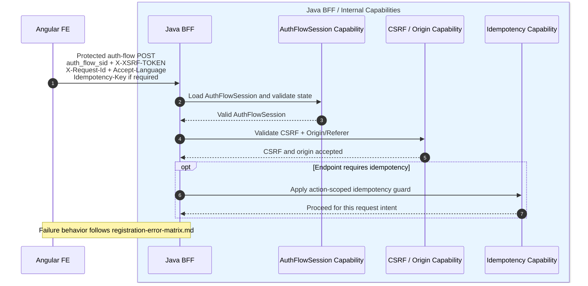
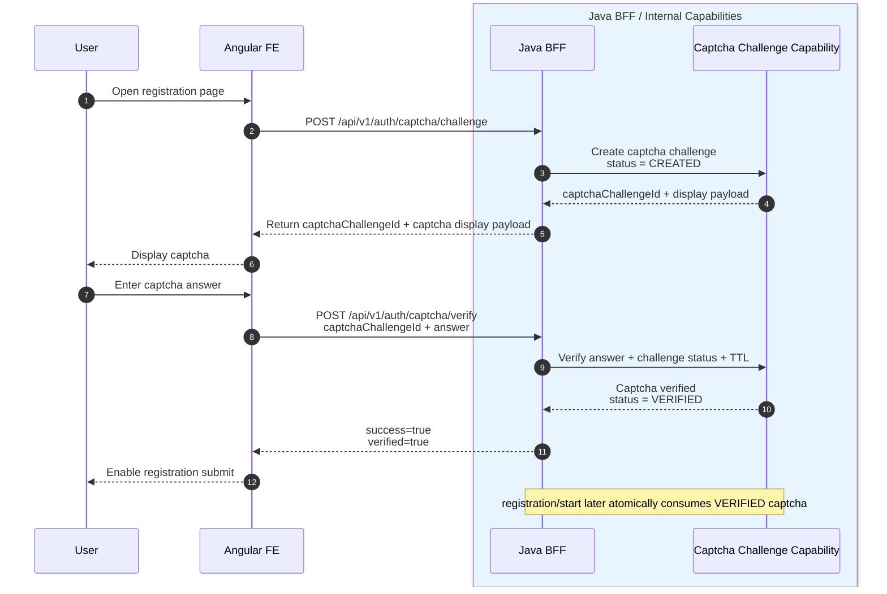
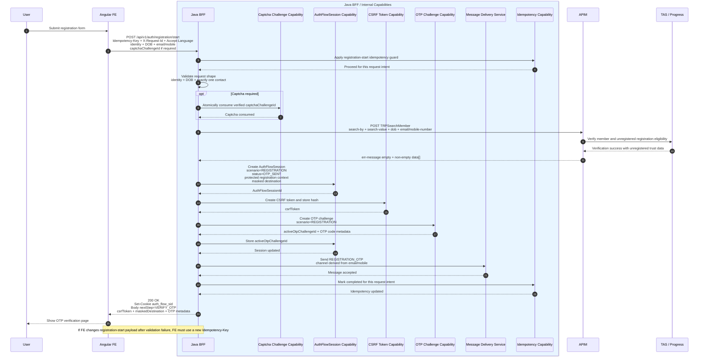
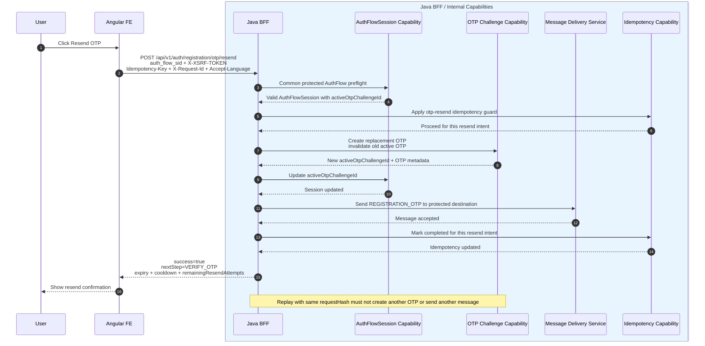
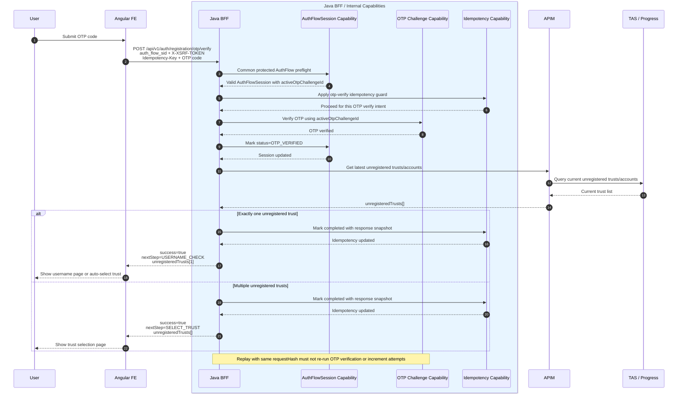
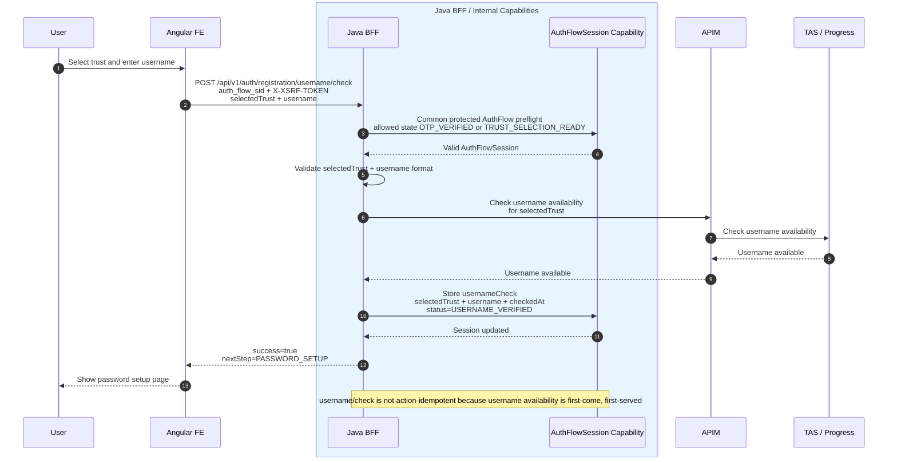
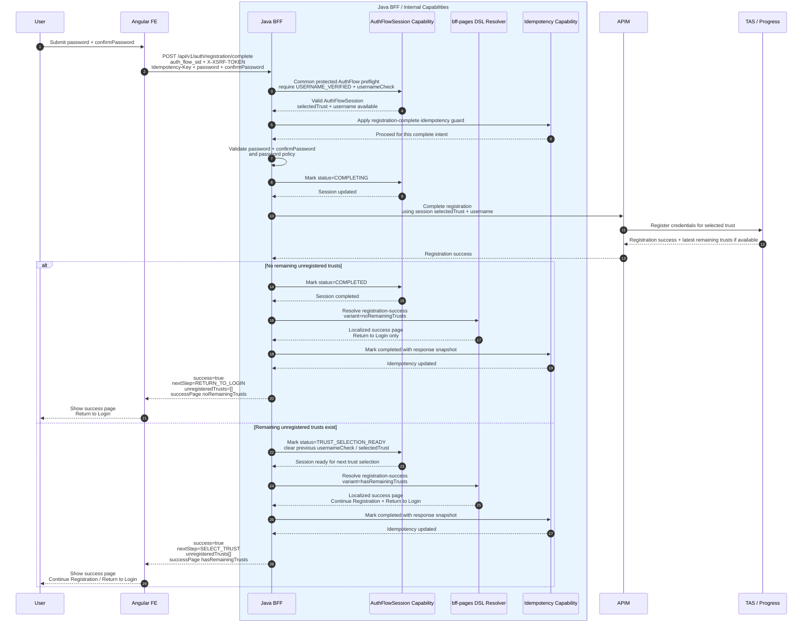
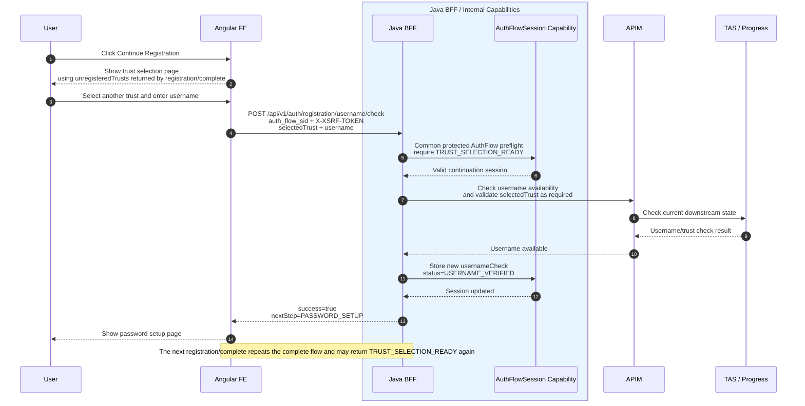
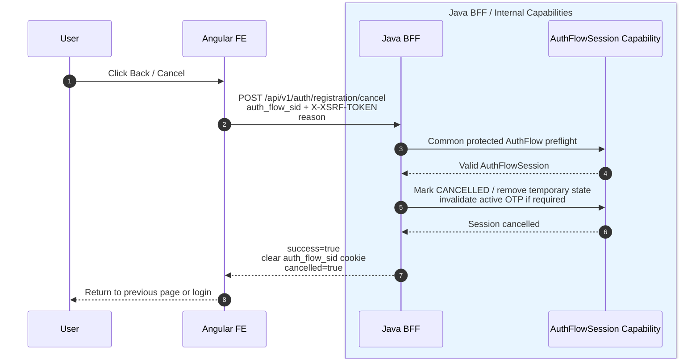

# Registration Sequence Diagrams

## Purpose

These diagrams show the major successful interaction flows and state transitions for the registration AuthFlow.

They intentionally omit detailed failure handling, validation branches, retry/idempotency branches, and low-level Redis read/write details.

For detailed behavior, use the purpose-specific contract documents:

- `registration-state-contract.md` — runtime state, Redis shapes, status transitions.
- `authflow-session-security-contract.md` — cookie, CSRF, Origin/Referer, rate limit, security rules.
- `registration-api-contract.md` — FE-facing endpoint requests/responses.
- `registration-apim-contract.md` — APIM/TAS request mapping and downstream classification.
- `registration-error-matrix.md` — all failure conditions, log severity, event type, state impact, idempotency behavior.
- `registration-implementation-checklist.md` — P9/P10 tasks and tests.

## Diagram Conventions

- Happy path is shown first.
- Error paths are summarized with notes and delegated to `registration-error-matrix.md`.
- Idempotency is shown as a guard, not expanded into all replay branches.
- Redis is hidden behind Java-owned capabilities unless the interaction is central to the flow.
- SMS and email are collapsed into Message Delivery.
- AuthFlowSession uses `auth_flow_sid` HttpOnly cookie and server-side Redis state.
- CSRF token is returned by `registration/start`, stored by FE in memory, and remains stable for the AuthFlowSession lifetime unless Java explicitly returns a new `result.csrfToken`.
- `auth/flow/resume` is out of current BRD scope. If FE loses in-memory CSRF token, FE restarts registration.

---

## Common Protected AuthFlow Request Preflight

Applies to:

- `POST /api/v1/auth/registration/otp/resend`
- `POST /api/v1/auth/registration/otp/verify`
- `POST /api/v1/auth/registration/username/check`
- `POST /api/v1/auth/registration/complete`
- `POST /api/v1/auth/registration/cancel`

Common BFF behavior:

1. Load AuthFlowSession using `auth_flow_sid` cookie.
2. Validate CSRF token from `X-XSRF-TOKEN`.
3. Validate Origin/Referer.
4. Validate current workflow state.
5. Apply action-scoped idempotency guard if the endpoint requires it.
6. Resolve failures through `registration-error-matrix.md`.

---

## 1. Captcha Challenge and Verify

Captcha is confirmed for registration.

This diagram shows the normal captcha lifecycle. Invalid, expired, locked, consumed, and rate-limited cases are defined in `registration-error-matrix.md`.

---

## 2. Registration Start + AuthFlowSession + OTP Send

This diagram shows successful registration-start verification, AuthFlowSession creation, CSRF issuance, OTP creation, and OTP delivery.

Detailed validation failures, APIM/TAS business rejections, captcha failures, message delivery failures, and idempotency replay behavior are defined in `registration-error-matrix.md`.

---

## 3. OTP Resend

This diagram shows the successful resend flow only.

Cooldown, max resend, invalid session, CSRF failure, message delivery failure, and duplicate/replay behavior are defined in `registration-error-matrix.md`.

---

## 4. OTP Verify + Current Unregistered Trust Lookup

This diagram shows OTP verification and latest trust lookup.

OTP invalid, expired, locked, APIM/TAS lookup failure, idempotency replay, and session/CSRF failures are defined in `registration-error-matrix.md`.

---

## 5. Username Check

This diagram shows username availability checking and storing the current registration target in AuthFlowSession.

Username unavailable, invalid state, invalid username, APIM/TAS rejection, and technical failures are defined in `registration-error-matrix.md`.

---

## 6. Registration Complete + Multi-Trust Continuation

This diagram shows registration completion and the multi-trust continuation state.

APIM/TAS business failures, password validation, unknown downstream outcome, and idempotency replay behavior are defined in `registration-error-matrix.md`.

---

## 7. Continue Registration From Remaining Trusts

This diagram shows how FE continues from the success page when remaining trusts exist.

The user does not repeat captcha, registration/start, or OTP while the AuthFlowSession remains valid.

---

## 8. Cancel / Back

Cancel is intentionally small here. CSRF/session failure behavior is in `registration-error-matrix.md`.

Lost CSRF behavior:

- If FE lost the in-memory CSRF token, FE must not call `registration/cancel`.
- The old AuthFlowSession expires naturally.
