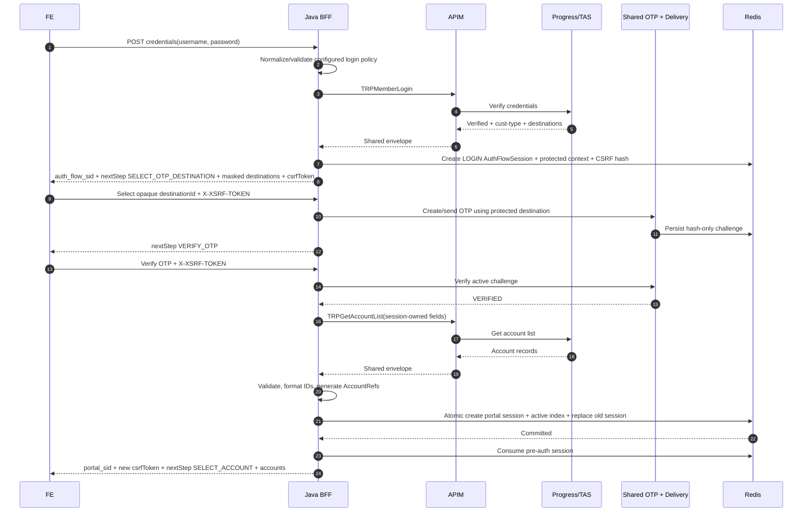
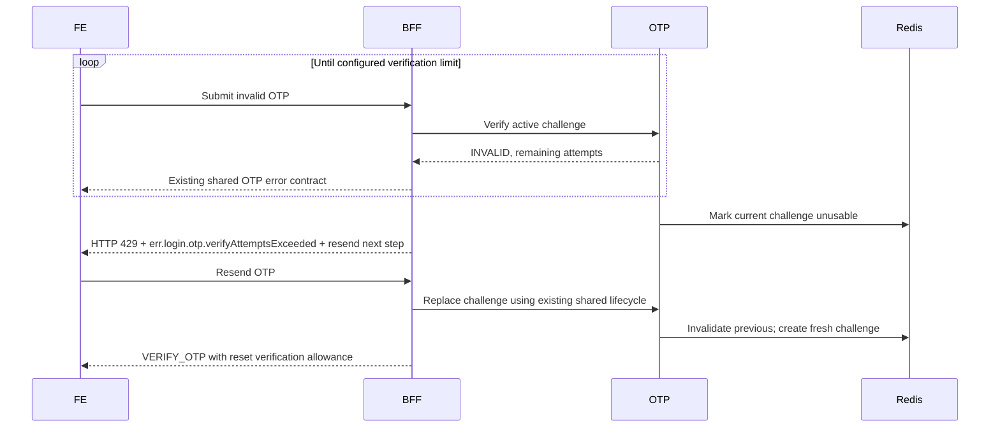
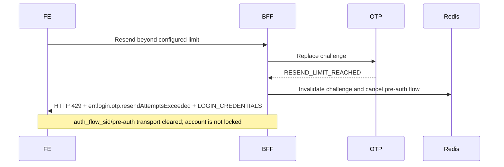
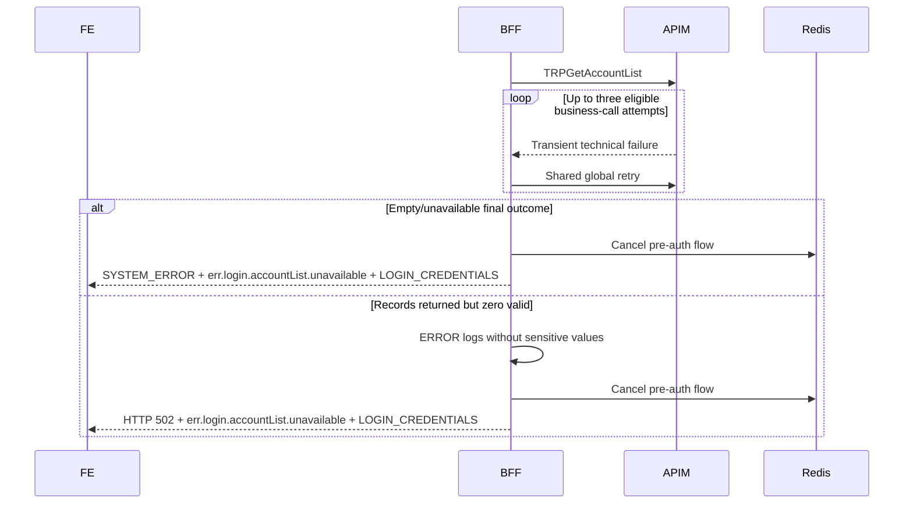
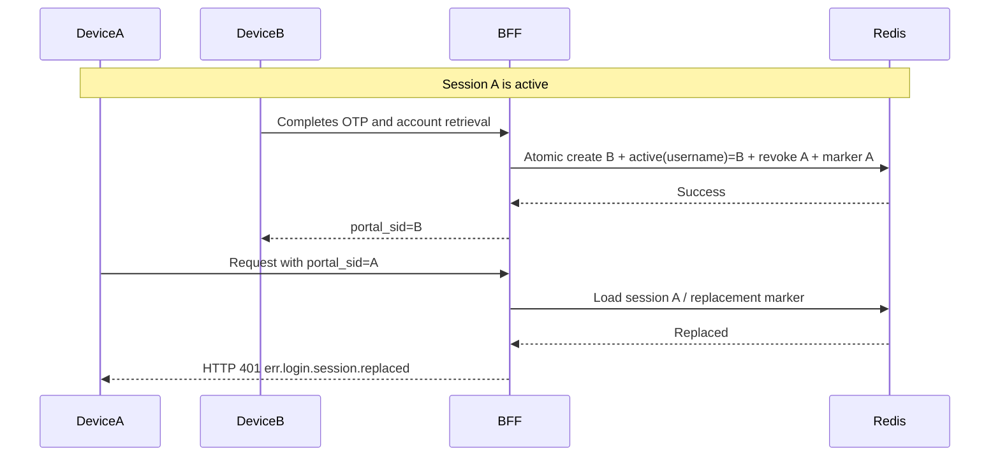
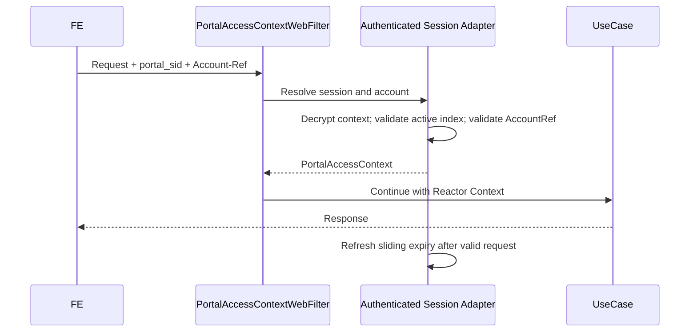

> Status: Design baseline v0.1  
> Date: 20 July 2026  
> Scope: Subsequent member login plus reusable authentication foundations  
> Source baseline: Login BRD V0.3, discovery decisions in 02-brd.md through 10-brd.md, and the supplied current codebase snapshot  
> Open external dependency: detailed `TRPGetAccountList` business failure-code mapping remains TBC.

# Login Sequence Diagrams

## 1. Successful login

## 2. OTP verification exhausted but resend remains

## 3. Resend exhausted

## 4. Account-list unusable

## 5. Last login wins

## 6. Account-scoped request

