# Username Recovery Sequence Diagrams

These Mermaid diagrams describe the canonical no-OTP Username Recovery flow.

## 1. Captcha challenge and verification

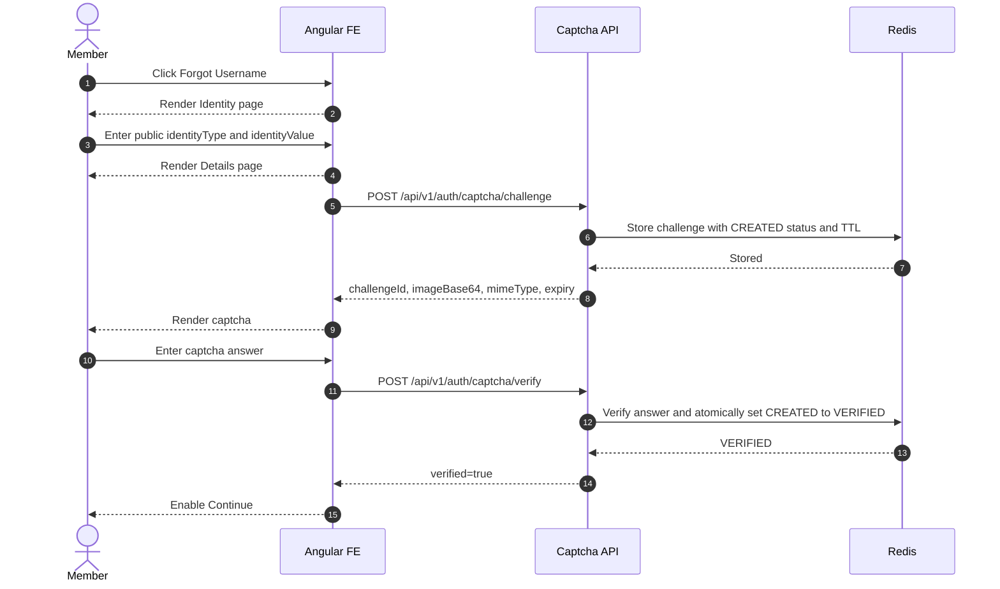

## 2. Captcha refresh

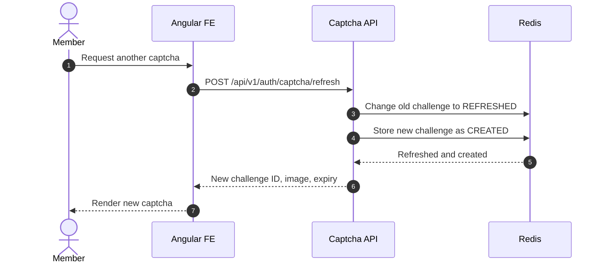

## 3. Successful start with registered schemes

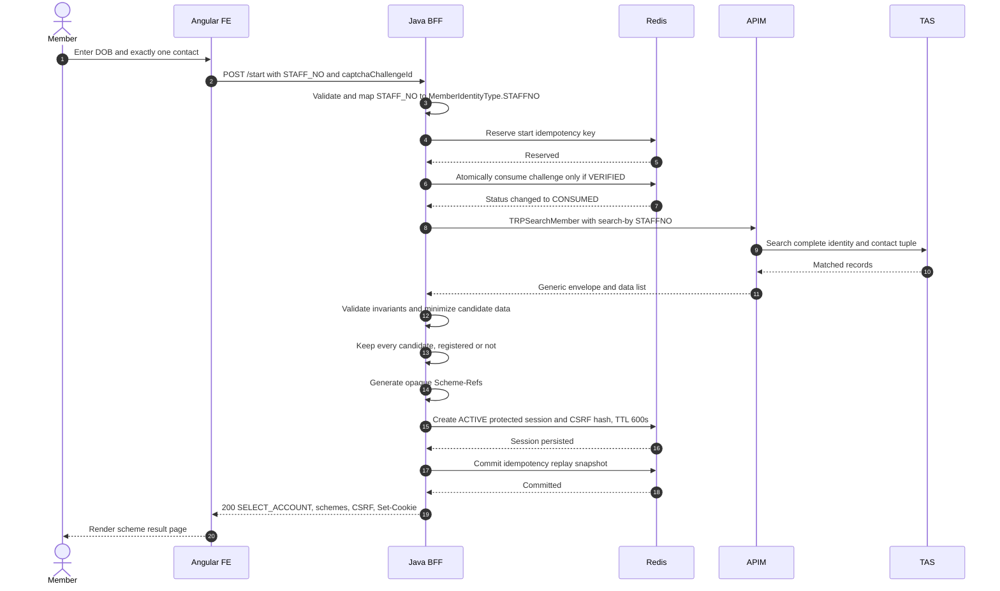

## 4. Member not found

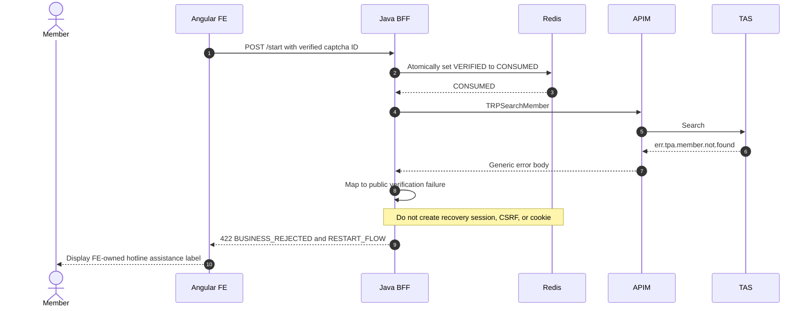

## 5. Only unregistered schemes

```mermaid
sequenceDiagram
    autonumber
    actor U as Member
    participant FE as Angular FE
    participant BFF as Java BFF
    participant REDIS as Redis
    participant APIM as APIM

    BFF->>APIM: TRPSearchMember
    APIM-->>BFF: Records with isRegistered=false only
    BFF->>BFF: Generate opaque Scheme-Refs for every record
    BFF->>REDIS: Create ACTIVE protected session and CSRF hash, TTL 600s
    REDIS-->>BFF: Session persisted
    BFF-->>FE: 200 SELECT_ACCOUNT, schemes with isRegistered=false, CSRF, Set-Cookie
    FE-->>U: Show Registration reminder; request action disabled on every row
    Note over BFF,FE: /request for an unregistered Scheme-Ref returns UNREGISTERED_CANDIDATE, no delivery
```

## 6. Request username while another remains unrequested

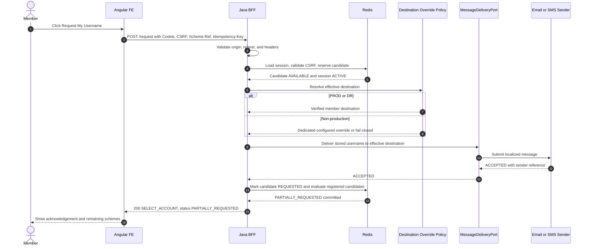

## 7. Final username request completes workflow

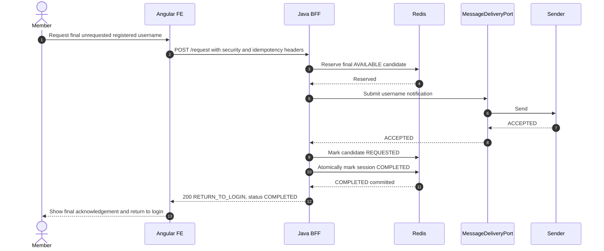

## 8. Idempotent replay and no resend

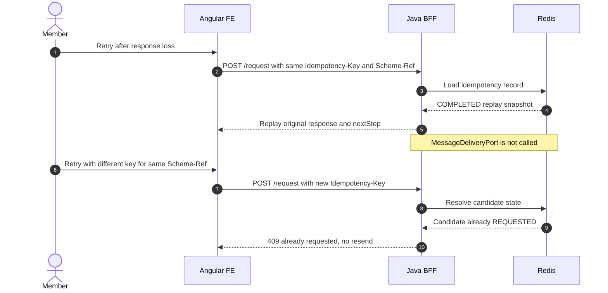

## 9. Delivery unknown outcome

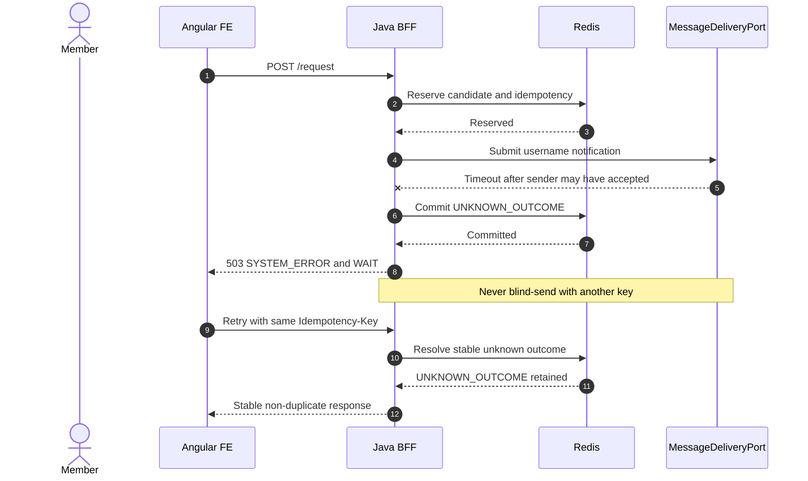

## 10. Mapped system failure with no silent catch

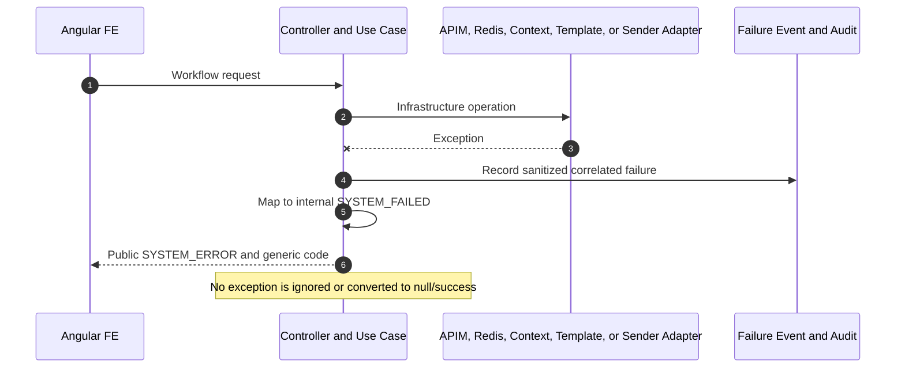

## 11. Cancel

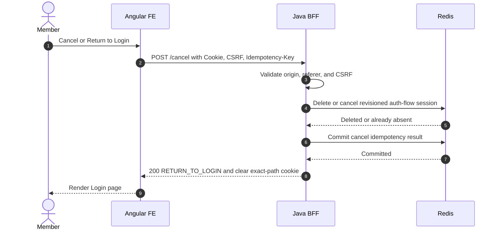

## 12. Local development through Angular proxy

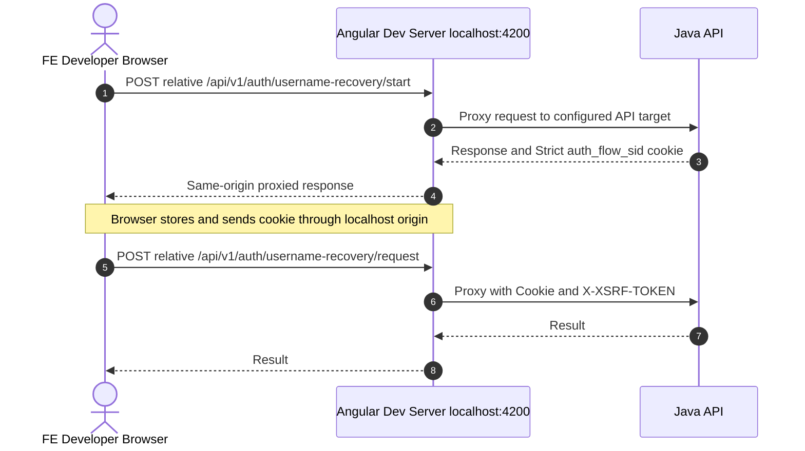
