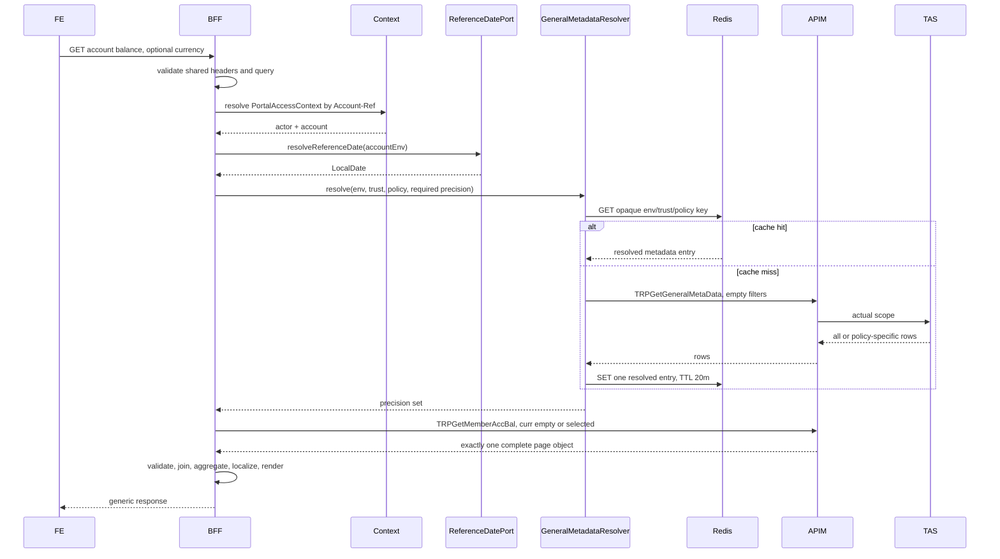

# Account Balance Sequence Diagrams

**Feature:** 6.14 Account Balance  
**Baseline:** 27/08/2026  
**Status:** Consolidated design baseline, pending repository investigation  

## Page load

## Phase I Repository Ratification

The repository investigation ratifies these physical boundaries:

- `X-Request-Id` is the only header universally rejected when missing by the shared pre-controller mandatory-header filter. Only `X-Request-Id` is propagated to APIM.
- `Accept-Language` is optional. When supplied, the existing shared language resolver selects English or Traditional Chinese TAS descriptions. Missing, blank, or unsupported values resolve to English. Account Balance adds no language parser and does not return `VALIDATION_FAILED` for an absent language.
- `Account-Ref` is required by the existing selected-account context-resolution path, not by an Account Balance controller validator. `PortalAccessContextWebFilter` resolves and publishes `PortalAccessContext` to Reactor Context and exchange attributes; `CurrentPortalAccessContextResolver.current()` is the controller reuse point. `Account-Ref` is neither sent to APIM nor echoed to FE.
- `Idempotency-Key` is absent from the naturally repeatable Account Balance GET contract. No idempotency store, replay record, or idempotency adapter is introduced.
- `MutationResponse` is the target public envelope. `ApiResponse` is obsolete and must not be introduced.
- Technical failures use HTTP 503, `SYSTEM_ERROR`, `err.system.unavailable`, and `errors[].type=SYSTEM`. `PAGE` and `GLOBAL` are not error types.
- Portfolio omission uses scoped Jackson inclusion on Account Balance response DTO fields. Global `ObjectMapper` inclusion must not change. Hidden overview `vestedBalance` and `pendingSwitchIn` remain present as JSON null; hidden `fxRate` and blank or malformed `factsheetUrl` are omitted.
- `ContributionController#getContributionSummary` and `ContributionControllerTest` are the primary physical controller and test patterns. Account Balance preserves its optional `currency`, selected-account context, optional language fallback, both result views, and absence of `Idempotency-Key`; contribution business DTOs and logic are not copied.
