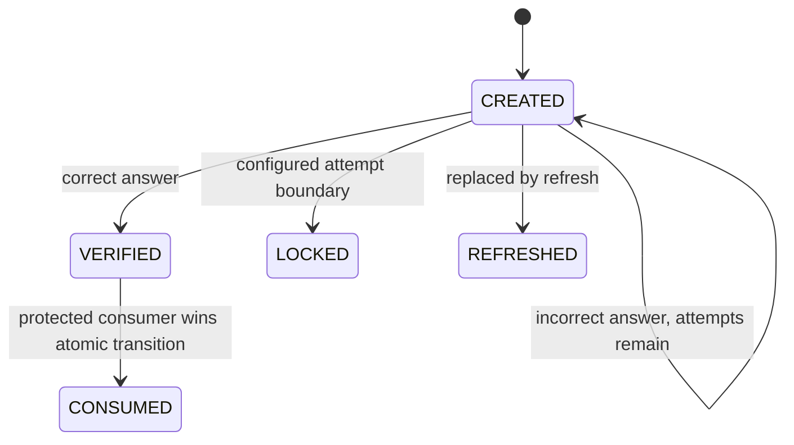

# Captcha Lifecycle, Verification, Consumption, and Public Contract

## Authority and scope

This is the canonical active contract for the reusable captcha capability. It supersedes active descriptions that treat repeated verification as success, make Registration own standalone captcha errors, or describe consumption as an ordinary update. Historical prompts, plans, and execution evidence retain their original context.

## Lifecycle



| State | Allowed incoming transitions | Allowed outgoing transitions | Verification eligible | Consumption eligible | Timestamp | Answer hash | TTL and disclosure |
|---|---|---|---|---|---|---|---|
| `CREATED` | creation; incorrect answer remains `CREATED` | `VERIFIED`, `LOCKED`, `REFRESHED` | Yes | No | `createdAt` | retained | Original positive TTL is preserved. Internal state is concealed on ineligible public verification. |
| `VERIFIED` | `CREATED` after correct answer | `CONSUMED` | No | Yes | `verifiedAt` | retained until successful consumption | Re-verification is rejected. A rejected re-verification leaves one legitimate consumption available. |
| `CONSUMED` | atomic protected consumption from exact `VERIFIED` record | none | No | No | `consumedAt` | cleared | Terminal and publicly concealed by standalone verification. |
| `LOCKED` | configured failed-attempt boundary | none | No | No | `lockedAt` | retained for the ephemeral record | Terminal and publicly concealed by standalone verification. |
| `REFRESHED` | active challenge replaced by refresh | none | No | No | `refreshedAt` | cleared by the lifecycle model | Terminal and publicly concealed by standalone verification. |
| `EXPIRED` or expired-by-time | TTL or time eligibility ended | none | No | No | expiry is represented by `expiresAt` | implementation-owned until expiry | Unusable and publicly concealed by standalone verification. |

No terminal or ineligible state can be revived by verification or consumption. `VERIFIED -> VERIFIED` is not a successful transition.

## Normative transition assertions

- `CREATED` is verification-eligible and is the only verification-eligible state.
- `CREATED -> VERIFIED` is the successful first-verification transition.
- `VERIFIED -> CONSUMED` is the separate protected-consumption transition.
- `CREATED -> CREATED` applies after an incorrect answer while attempts remain.
- `CREATED -> LOCKED` applies at the configured attempt boundary.
- `CREATED -> REFRESHED` applies when refresh replaces the challenge.

## Verification versus consumption

Verification establishes eligibility for one later protected operation. The standalone verify endpoint never performs the protected operation and never consumes a challenge. Only `CREATED` can be answer-verified. A request against `VERIFIED`, `CONSUMED`, `REFRESHED`, `LOCKED`, expired, or missing state is lifecycle-ineligible.

A repeated HTTP request is not transport idempotency. Captcha verification has no request-key and request-hash replay contract. A repeated verify of a `VERIFIED` challenge is a new ineligible request, even when the answer is the same. Correct and incorrect answers produce the same public rejection; the answer is not compared, the record is not mutated, attempts are not incremented, and TTL is not extended.

Consumption is a separate application capability. Registration and Username Recovery currently use `RegistrationCaptchaGateService`. The gate requires the exact expected `VERIFIED` record, performs one compare-and-replace operation, and permits at most one winner. A conflict is non-success and causes at most one authoritative reload for classification. Consumers never re-check the answer.

## Atomic persistence contract

Verification and consumption use exact expected-state compare-and-replace. The operation requires a valid positive remaining TTL, preserves that TTL, returns only strict documented outcomes, and fails closed on unsupported or infrastructure results. Verification retries no mutation after conflict and reloads at most once. Consumption also reloads at most once after conflict. Successful consumption preserves lifecycle metadata, sets `consumedAt`, and clears the answer hash. No public document publishes raw scripts, Redis keys, serialized records, hashes, or operational secrets.

## Standalone API contract

### Challenge

`POST /api/v1/auth/captcha/challenge` creates a new `CREATED` challenge and returns display metadata. The answer and answer hash are never returned.

### Verify

`POST /api/v1/auth/captcha/verify` accepts `captchaChallengeId` and the answer only for standalone verification.

- First correct verification: HTTP 200, `SUCCESS`, `verified=true`, status becomes `VERIFIED`.
- Incorrect answer with attempts remaining: approved validation failure with the remaining-attempt field; status stays `CREATED`.
- Attempt boundary: the challenge becomes `LOCKED`; public fields follow the approved standalone response without exposing persistence details.
- Lifecycle-ineligible verification: exact HTTP 422 contract below.
- Missing or malformed fields: HTTP 400 with `err.request.validation.failed` or the applicable generic request error.
- System failure: the approved generic system response.
- Rate limiting: the approved generic rate-limit response and headers when configured.

Synthetic lifecycle-ineligible response:

```json
{
  "success": false,
  "status": "VALIDATION_FAILED",
  "result": {
    "nextStep": "NONE",
    "data": {
      "verified": false,
      "captchaChallengeId": null,
      "remainingAttempts": 0
    }
  },
  "messages": [],
  "errors": [
    {
      "type": "FIELD",
      "code": "err.captcha.verification.invalid",
      "targets": ["captchaAnswer"],
      "severity": "ERROR",
      "source": "SERVER"
    }
  ]
}
```

The internal reason is intentionally concealed. The response does not reveal whether the challenge is verified, consumed, refreshed, expired, locked, or missing.

### Refresh

`POST /api/v1/auth/captcha/refresh` replaces an eligible active challenge with a new `CREATED` challenge. The old challenge cannot be revived or used as a verification or consumption bypass.

## Public error ownership matrix

| Error | Owner and emitter | HTTP and API status | Type and target | Next step | Disclosure and localization |
|---|---|---|---|---|---|
| `err.captcha.verification.invalid` | Standalone captcha verify | 422, `VALIDATION_FAILED` | `FIELD`, `captchaAnswer` | `NONE` | Conceals all internal lifecycle reasons. Frontend localizes the configured code. |
| `err.request.validation.failed` | Generic request validation for malformed or missing standalone fields | 400, `VALIDATION_FAILED` | configured field/form target | `NONE` | Reveals only safe request-shape detail. Frontend localizes the configured code. |
| Approved generic system and rate-limit codes | Shared infrastructure or rate-limit boundary | configured 5xx or 429 and API status | configured metadata | configured | No internal keys, values, secrets, or lifecycle reason. |
| `err.registration.captcha.*` | Registration start and consumption workflow | workflow-configured status | workflow-configured target | workflow-owned | May classify Registration outcomes but is never emitted by standalone captcha endpoints. |
| Approved Username Recovery captcha errors | Username Recovery start workflow | workflow-configured status | workflow-owned target | workflow-owned | Does not leak internal state beyond the approved Username Recovery contract. |

## Consumer responsibilities

Registration and Username Recovery submit only `captchaChallengeId`, never the answer. Both consume through the shared application gate, never through Redis adapters. Rejection stops later lookup, session, OTP, message, idempotency-completion, and other workflow side effects where applicable. Registration retains Registration-owned errors. Username Recovery retains Username Recovery-owned errors and does not use OTP. Completed idempotency replay does not consume again.
